# ApoF Tutorial with an AI Assistant (MCP)

> [!NOTE]
> Everything on this page was done in a real run on 23–24 October 2026, on the MPCDF *phys*
> cluster. The conversations are the actual prompts and answers, unedited. The only tool
> calls left out are Claude Code loading the tools' definitions. The screenshots of the
> EMhub web interface were taken during the run. The assistant made every change in EMhub;
> no command was typed and no button was clicked.

This page repeats the [Warp ApoF Tutorial](https://3dem.github.io/emhub-tomo/warp_apof_tutorial.html) with an AI assistant doing the work.
You describe what you want in plain language. The assistant then:

- creates the project and loads the workflows;
- checks the parameters, queues and GPUs;
- schedules the jobs on the cluster and follows them;
- answers questions about the results, such as particle counts, resolution and
  failed jobs.

It works through **emhub-tomo-mcp**, a server for the
[Model Context Protocol](https://modelcontextprotocol.io) (MCP). MCP lets an assistant
such as Claude Code, Claude Desktop or VS Code use EMhub-Tomo through EMhub's REST API.
The assistant sees only what the server offers, and the server checks every change
before it reaches EMhub.

You need the same data and installation as the original tutorial. This page covers the
MCP part only; for what each job does, see [Warp ApoF Tutorial](https://3dem.github.io/emhub-tomo/warp_apof_tutorial.html).

## What the Assistant Can and Cannot Do

The server has three access levels. The operator sets the level, and the assistant
cannot change it.

| Level | The assistant can |
|---|---|
| `read` (default) | List projects, read jobs, parameters, logs and files, explain failures, follow running jobs. It cannot change anything. |
| `operate` | Also create projects, load workflows, edit parameters, run, schedule and stop jobs, and label, copy and export jobs. This page uses `operate`. |
| `admin` | Also delete jobs and re-run jobs from a clean folder. |

Before any change, the server checks:

- the job's status;
- the parameters, against the job's form and with EMhub's own validation;
- that GPU jobs go to a cluster queue, never to the login node;
- the limits on GPUs per job, GPU jobs at once and launches per hour.

It also keeps an audit log of every change. Most change tools have a *dry run*, which
shows what would happen without changing anything. The assistant is told to show you
the plan and ask before it runs anything.

## Before You Start

* **EMhub-Tomo** installed and configured, with working launchers for Warp, RELION,
  PyTOM and AreTomo, and the ``WarpApofTutorial`` test data. See [EMhub-Tomo documentation](https://3dem.github.io/emhub-tomo/) and
  [Test Data](https://3dem.github.io/emhub-tomo/test_data.html).
* **An MCP client.** This page uses [Claude Code](https://claude.com/claude-code)
  (version 2.1) in a terminal on the cluster's login node. Claude Desktop and VS Code
  work the same way.
* **emhub-tomo-mcp**, installed with [uv](https://docs.astral.sh/uv/) from a checkout of
  the emhub repository. It needs Python ≥ 3.10, independent of the EMhub-Tomo
  environment:

  ```bash
  uv tool install ./emhub-tomo-mcp
  emhub-tomo-mcp --version
  ```

> [!WARNING]
> The MCP server, and three small additions to EMhub's REST API that it uses
> (``validate_job``, ``get_job_types``, and the template jobs in ``get_workflows``), are on
> the emhub branch ``dev-sc_mcp_server``. They are not merged yet. Until they are, run
> EMhub-Tomo from that branch to get every feature. Against an EMhub without them, the
> server still works, but it lists no workflow templates and only checks parameters
> against the forms.

## Connecting the Assistant to EMhub-Tomo

Start EMhub-Tomo as usual. Note the port it prints:

```bash
./emh-tomo --run
```

Then tell Claude Code how to start the MCP server. Put a file named ``.mcp.json`` in the
folder where you run ``claude``. This is the configuration used for this page, with the
folders replaced by examples:

```json
{
  "mcpServers": {
    "emhub-tomo": {
      "command": "emhub-tomo-mcp",
      "env": {
        "EMHUB_SERVER_URL": "http://127.0.0.1:${EMHUB_TOMO_PORT}",
        "EMHUB_TOMO_MCP_AUTH": "autologin",
        "EMHUB_TOMO_MCP_ACCESS": "operate",
        "EMHUB_TOMO_MCP_ALLOWED_ROOTS": "/ptmp/${USER}/projects:/ptmp/${USER}/testdata",
        "EMHUB_TOMO_MCP_DEFAULT_QUEUE": "phys-a",
        "EMHUB_TOMO_MCP_MAX_GPUS_PER_JOB": "3",
        "EMHUB_TOMO_MCP_MAX_ACTIVE_GPU_JOBS": "2",
        "EMHUB_TOMO_MCP_STATE_DIR": "/ptmp/${USER}/.emhub-tomo-mcp"
      }
    }
  }
}
```

* ``EMHUB_SERVER_URL`` is the address ``./emh-tomo --run`` printed. Claude Code fills in
  ``${EMHUB_TOMO_PORT}`` from your shell, so set it before starting ``claude``.
* ``autologin`` matches ``./emh-tomo --run``, which logs every request in as ``admin``.
* ``ALLOWED_ROOTS`` lists the only folders where the assistant may create projects or
  point at raw data.
* ``DEFAULT_QUEUE`` and the two GPU limits keep GPU jobs on the cluster, within your
  share of it.
* For read-only use, leave out everything after ``EMHUB_TOMO_MCP_AUTH``.

All settings are described in the emhub-tomo-mcp documentation ([configuration.md](configuration.md)).

Check the connection from the same terminal. Inside Claude Code, ``/mcp`` shows the
server and its tools.

```text
$ EMHUB_SERVER_URL=http://127.0.0.1:$EMHUB_TOMO_PORT EMHUB_TOMO_MCP_AUTH=autologin emhub-tomo-mcp --check
emhub-tomo-mcp 1.0.0
EMhub URL:        http://127.0.0.1:37207
Authentication:   autologin
Acting as:        admin (roles: admin)
Visible projects: 0
/api/get_workflows: yes
/api/get_job_types: yes
/api/validate_job: yes
Warning: EMHUB_USER is not set; assuming the emh-tomo auto-login user 'admin' for project visibility.
OK
```

The warning is harmless with ``./emh-tomo --run``. Add ``"EMHUB_USER": "admin"`` to the
``env`` block to silence it.

## Getting Started

Start ``claude`` and ask what is there. The first box below is what was typed. Under it,
a collapsed list shows the tools the assistant called; click it to see each call and its
arguments. The last box is the answer.

**You:**

> Is my EMhub-Tomo server working? Which projects do I have, and which workflow templates can I use?

<details><summary>4 tool calls: get_server_status, list_projects, list_workflow_templates</summary><ol><li><code>get_server_status()</code></li><li><code>list_projects(include_job_counts=true)</code></li><li><code>list_workflow_templates()</code></li><li><code>list_projects(scope=&quot;all&quot;, include_job_counts=true)</code></li></ol></details>

**Assistant:**

> Your server is working, but you don't have any projects on it yet.
>
> **Server status**
>
> - The EMhub-Tomo server (version 1.0.0) is connected to EMhub at `http://127.0.0.1:37207`.
> - It's logged in as `admin`, which has admin rights, with access level `operate`. That means it can create, edit, run and schedule jobs, not only read them.
> - It gave one warning: `EMHUB_USER` isn't set, so it assumed the auto-login user `admin`. This isn't why the project list is empty. I listed projects as admin across all users, which shows everything, and still got zero.
>
> **Projects**
>
> None are registered on this EMhub instance, even counting other users' projects.
>
> **Workflow templates (6)**
>
> | ID | Title | What it does |
> |---|---|---|
> | `apof-aretomo3` | ApoF – AreTomo3 preprocessing | Import tilt series → AreTomo3 → Warp motion/CTF → AreTomo3 alignment → AreTomo3 reconstruction (5 jobs) |
> | `apof-warp-tutorial-part1` | ApoF – Warp + PyTOM + Relion | The full ApoF tutorial up to the start of M: import → Warp motion/CTF → alignment → CTF/reconstruction → PyTOM template matching → particle export → RELION initial model and Refine3D → mask → M population (11 jobs) |
> | `apof-warp-tutorial-part2` | ApoF – M Refinements | The M refinement part of the tutorial: 7 M refinement rounds, 2 weight-estimation steps and 1 resampling step (11 jobs) |
> | `apof-warp-tutorial-otf` | apof-warp-tutorial-otf | Import tilt series → Warp on-the-fly (2 jobs, no description) |
> | `tomo-otf` | Tomo On-The-Fly | Imports tilt series while they're being collected, runs Warp and AreTomo3 on them, and feeds a tilt-analysis job to the EMhub cryo-ET dashboard (4 jobs) |
> | `spa-otf` | SPA On-The-Fly | Single-particle on-the-fly processing: movie import → batches of preprocessing (MotionCor, ctffind, crYOLO, extraction) → RELION 2D classification (3 jobs) |
>
> To get started, I can create a project and load one of these templates into it, for example `apof-warp-tutorial-part1` for the ApoF tutorial. I'd need the project folder and the data path from you, and I won't run or schedule anything without asking you first.

<sub>4 tool calls · 23 s</sub>


## Creating a Project and Loading Part 1

Give the assistant what you would type into the project form: a title, the processing
folder (the last folder must not exist yet), and the raw data folder, which becomes the
``data`` link inside the project. Then ask for the workflow.

**You:**

> Create a project titled 'ApoF tutorial (MCP)' with the processing folder /ptmp/secruz/software_development/emHubTomo/dev/projects/mcp_apof_tutorial and the raw data in /ptmp/secruz/software_development/emHubTomo/testdata/WarpApofTutorial. Then load the ApoF tutorial part 1 workflow into it. Don't run anything yet.

<details><summary>3 tool calls: create_project, load_workflow_template, get_project</summary><ol><li><code>create_project(title=&quot;ApoF tutorial (MCP)&quot;, processing_path=&quot;/ptmp/secruz/software_development/emHubTomo/dev/projects/mcp_apof_tutorial&quot;, data_path=&quot;/ptmp/secruz/software_development/emHubTomo/testdata/WarpApofTutorial&quot;)</code></li><li><code>load_workflow_template(project_id=1, workflow_id=&quot;apof-warp-tutorial-part1&quot;)</code></li><li><code>get_project(project_id=1)</code></li></ol></details>

**Assistant:**

> I created the project and loaded the part 1 workflow into it. All 11 jobs are saved, and nothing has run or been scheduled.
>
> **Project 1: ApoF tutorial (MCP)**
>
> - **Processing folder:** `/ptmp/secruz/software_development/emHubTomo/dev/projects/mcp_apof_tutorial`
> - **Raw data:** `/ptmp/secruz/software_development/emHubTomo/testdata/WarpApofTutorial`, linked as `data/` inside the project
>
> **Jobs**
>
> The template's job numbers were renumbered in order, so the jobs are now `job001` to `job011`.
>
> | Job | Type | Uses output of |
> |---|---|---|
> | `EMwrap/job001` | Import tilt series | — |
> | `PyTom/job002` | Create PyTOM template | — |
> | `WarpMctf/job003` | Warp motion correction + CTF | job001 |
> | `WarpTsAlign/job004` | Tilt-series alignment | job003 |
> | `WarpCtfRec/job005` | CTF + tomogram reconstruction | job004 |
> | `PyTom/job006` | PyTOM template matching | job005, job002 |
> | `WarpExportParticles/job007` | Particle export | job005, job006 |
> | `InitialModel/job008` | RELION initial model | job007 |
> | `Refine3D/job009` | RELION Refine3D | job007, job008 |
> | `External/job010` | Mask creation | job009 |
> | `WarpMCreatePopulation/job011` | Create M population | job010, job009 |
>
> The links between jobs match the template. `EMwrap/job001` and `PyTom/job002` are ready to run now because they don't depend on any other job. The rest will start as their parent jobs finish once you schedule the pipeline.
>
> I haven't looked at the job settings yet. Before you run anything, I can review them: the import job's file pattern against what's actually in `data/`, plus each job's queue and GPU settings. I can also do a dry run of scheduling the whole pipeline, which shows which queue and GPUs each job would use without starting anything.

<sub>3 tool calls · 24 s</sub>


The project now appears on the *Tomo Processing* page, with the 11 jobs of part 1 saved
and linked:

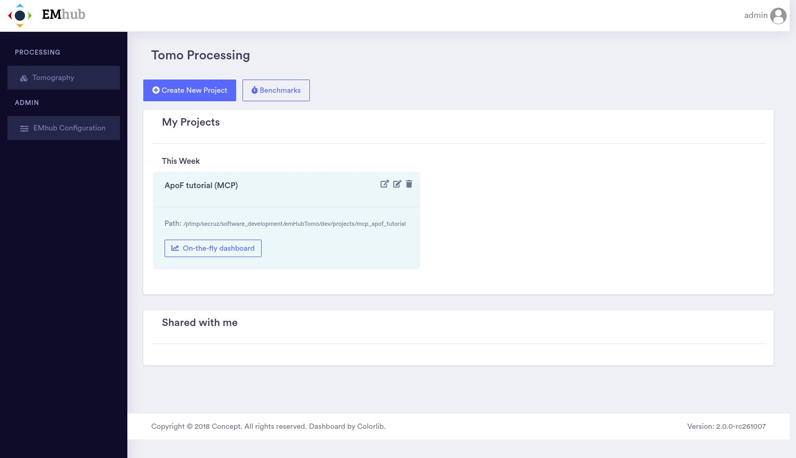

*The new project on the Tomo Processing page.*


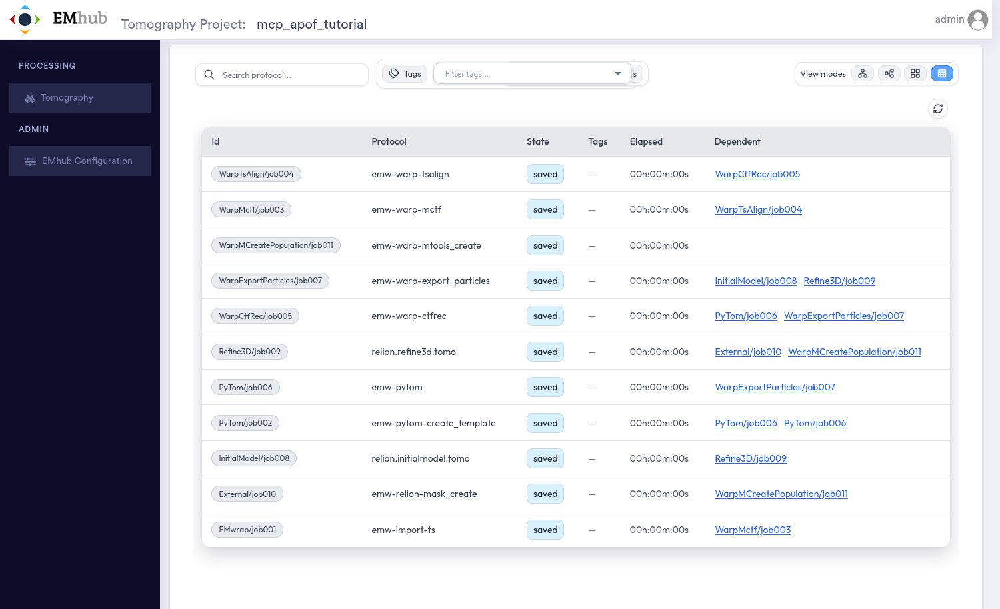

*The project in the table view: the 11 jobs of part 1, saved, with their dependent jobs.*


## Checking the Settings Before Running

Before anything runs, ask the assistant to check that the import finds the data, and
where each job will run. A *dry run* checks a change without making it.

**You:**

> Yes, please check the settings: does the import job find the data, and which queue and how many GPUs would each job use? Then do a dry run of scheduling the whole part 1 pipeline on the cluster. GPU jobs should go to phys-a with at most 3 GPUs each.

<details><summary>28 tool calls: get_jobs, list_project_files, describe_job_type, read_project_file, schedule_jobs, save_job, get_job</summary><ol><li><code>get_jobs(project_id=1, job_ids=[&quot;EMwrap/job001&quot;, &quot;PyTom/job002&quot;, &quot;WarpMctf/job003&quot;, &quot;WarpTsAlign/job004&quot;, &quot;WarpCtfRec/job005&quot;, &quot;PyTom/job006&quot;, &quot;Warp…)</code></li><li><code>list_project_files(project_id=1, path=&quot;data&quot;)</code></li><li><code>list_project_files(project_id=1, path=&quot;data/mdoc&quot;)</code></li><li><code>list_project_files(project_id=1, path=&quot;data/frames&quot;, limit=20)</code></li><li><code>describe_job_type(job_type=&quot;emw-warp-mctf&quot;, project_id=1)</code></li><li><code>describe_job_type(job_type=&quot;relion.refine3d.tomo&quot;, project_id=1)</code></li><li><code>read_project_file(project_id=1, path=&quot;data/mdoc/TS_1.mrc.mdoc&quot;, head_lines=45)</code></li><li><code>schedule_jobs(project_id=1, job_ids=[&quot;EMwrap/job001&quot;, &quot;PyTom/job002&quot;, &quot;WarpMctf/job003&quot;, &quot;WarpTsAlign/job004&quot;, &quot;WarpCtfRec/job005&quot;, &quot;PyTom/job006&quot;, &quot;Warp…, dry_run=true)</code></li><li><code>list_project_files(project_id=1, path=&quot;data/frames&quot;, pattern=&quot;2Dvs3D_53-1_*&quot;, limit=1)</code></li><li><code>list_project_files(project_id=1, path=&quot;data/frames&quot;, pattern=&quot;2Dvs3D_53-11_*&quot;, limit=1)</code></li><li><code>list_project_files(project_id=1, path=&quot;data/frames&quot;, pattern=&quot;2Dvs3D_53-17_*&quot;, limit=1)</code></li><li><code>list_project_files(project_id=1, path=&quot;data/frames&quot;, pattern=&quot;2Dvs3D_53-23_*&quot;, limit=1)</code></li><li><code>list_project_files(project_id=1, path=&quot;data/frames&quot;, pattern=&quot;2Dvs3D_53-32_*&quot;, limit=1)</code></li><li><code>save_job(project_id=1, job_id=&quot;Refine3D/job009&quot;, params={&quot;gpus&quot;: &quot;3&quot;, &quot;queue.name&quot;: &quot;phys-a&quot;}, dry_run=true)</code> (refused or failed)</li><li><code>get_job(project_id=1, job_id=&quot;Refine3D/job009&quot;, include_empty_params=true)</code></li><li><code>save_job(project_id=1, job_id=&quot;Refine3D/job009&quot;, params={&quot;gpus&quot;: &quot;3&quot;, &quot;queue.name&quot;: &quot;phys-a&quot;}, allow_unknown=true, dry_run=true)</code></li><li><code>save_job(project_id=1, job_id=&quot;InitialModel/job008&quot;, params={&quot;queue.name&quot;: &quot;phys-a&quot;}, dry_run=true)</code></li><li><code>save_job(project_id=1, job_id=&quot;Refine3D/job009&quot;, params={&quot;gpus&quot;: &quot;3&quot;, &quot;queue.name&quot;: &quot;phys-a&quot;}, allow_unknown=true)</code></li><li><code>save_job(project_id=1, job_id=&quot;InitialModel/job008&quot;, params={&quot;queue.name&quot;: &quot;phys-a&quot;})</code></li><li><code>save_job(project_id=1, job_id=&quot;PyTom/job002&quot;, params={&quot;queue.name&quot;: &quot;phys-a&quot;})</code></li><li><code>save_job(project_id=1, job_id=&quot;WarpMctf/job003&quot;, params={&quot;queue.name&quot;: &quot;phys-a&quot;})</code></li><li><code>save_job(project_id=1, job_id=&quot;WarpTsAlign/job004&quot;, params={&quot;queue.name&quot;: &quot;phys-a&quot;})</code></li><li><code>save_job(project_id=1, job_id=&quot;WarpCtfRec/job005&quot;, params={&quot;queue.name&quot;: &quot;phys-a&quot;})</code></li><li><code>save_job(project_id=1, job_id=&quot;PyTom/job006&quot;, params={&quot;queue.name&quot;: &quot;phys-a&quot;})</code></li><li><code>save_job(project_id=1, job_id=&quot;WarpExportParticles/job007&quot;, params={&quot;queue.name&quot;: &quot;phys-a&quot;})</code></li><li><code>save_job(project_id=1, job_id=&quot;WarpMCreatePopulation/job011&quot;, params={&quot;queue.name&quot;: &quot;phys-a&quot;})</code></li><li><code>get_jobs(project_id=1, job_ids=[&quot;EMwrap/job001&quot;, &quot;PyTom/job002&quot;, &quot;WarpMctf/job003&quot;, &quot;WarpTsAlign/job004&quot;, &quot;WarpCtfRec/job005&quot;, &quot;PyTom/job006&quot;, &quot;Warp…)</code></li><li><code>schedule_jobs(project_id=1, job_ids=[&quot;EMwrap/job001&quot;, &quot;PyTom/job002&quot;, &quot;WarpMctf/job003&quot;, &quot;WarpTsAlign/job004&quot;, &quot;WarpCtfRec/job005&quot;, &quot;PyTom/job006&quot;, &quot;Warp…, dry_run=true)</code></li></ol></details>

**Assistant:**

> The import job will find the data, and the scheduling dry run passes with every GPU job on `phys-a` and none using more than 3 GPUs. To get there I changed the settings of 9 saved jobs. Nothing has been scheduled or run.
>
> **Import job (`EMwrap/job001`)**
>
> - The pattern `data/mdoc/*.mrc.mdoc` matches 5 tilt series: TS_1, 11, 17, 23 and 32.
> - Each of the 5 has all 41 of its frames in `data/frames/`, and the gain reference `data/gain_ref.mrc` is there.
> - `data/frames/` holds 328 frames in total. The other 123 belong to 3 tilt series that have no mdoc file, so the import will skip them.
>
> **What I changed**
>
> - **Refine3D/job009:** reduced its GPUs from 4 to 3. The RELION form has no GPU field, so I had to force this edit past the server's form check.
> - **Queue:** set `phys-a` explicitly on all 9 GPU jobs. Before, 7 of them got `phys-a` only as the server's default, and the two RELION jobs (job008, job009) had no queue at all.
>
> **Queue and GPUs per job**
>
> The dry run checks the jobs but doesn't print queue and GPUs per job, so this table comes from the saved settings, which I read back after the edits.
>
> | Job | Queue | GPUs |
> |---|---|---|
> | `EMwrap/job001` import | none | 0 |
> | `PyTom/job002` create template | phys-a | 1 |
> | `WarpMctf/job003` | phys-a | 2 |
> | `WarpTsAlign/job004` | phys-a | 2 |
> | `WarpCtfRec/job005` | phys-a | 2 |
> | `PyTom/job006` template matching | phys-a | 2 |
> | `WarpExportParticles/job007` | phys-a | 2 |
> | `InitialModel/job008` | phys-a | 2 |
> | `Refine3D/job009` | phys-a | 3 (was 4) |
> | `External/job010` mask | none | 0 |
> | `WarpMCreatePopulation/job011` | phys-a | 1 |
>
> The two jobs without a queue don't use GPUs. I expect them to run on the EMhub host, but the dry run doesn't say where they will run.
>
> **Two things worth your attention**
>
> 1. **Refine3D will use only 2 of its 3 GPUs.** It's set to 3 processes on GPUs `0:1`: one coordinating process plus two workers, one per GPU. I can drop its request to 2 GPUs, or change its GPU setting so it uses all 3.
> 2. **The server may not treat the RELION jobs as GPU jobs.** In the dry run before my edits, it warned "no queue set, using phys-a" for the 7 non-RELION GPU jobs but said nothing for job008 and job009. It also didn't object to Refine3D asking for 4 GPUs. That suggests that, without an explicit queue, RELION GPU jobs might run on the EMhub host and skip the per-job GPU limit. My edits avoid this for this pipeline. I haven't confirmed it in the server code; if you want, I can look into it there.
>
> To start, say "schedule it": all 11 jobs will be queued, each starting when its parent jobs finish, with the server checking every 5 minutes.

<sub>28 tool calls · 111 s</sub>


> [!TIP]
> **What this review found**
>
> The review found a gap in the MCP server. The server only counted job types with a
> ``gpus`` parameter as GPU jobs. RELION jobs give their GPUs as ``gpu_ids`` instead, so
> without a queue they could have run on the login node. The assistant noticed, explained
> it, and set the queue on both RELION jobs. The server was then fixed (emhub-tomo-mcp
> commit ``c11cb74``) before the pipeline was scheduled.
>
> Since the fix, the server counts GPUs exactly as emwrap does when it submits a job:
> RELION's ``gpu_ids`` if set, otherwise ``gpus``. Its dry runs list each job's queue and
> GPUs, as in the next step. Lowering Refine3D's ``gpus`` from 4 to 3 had no effect:
> RELION jobs take their GPUs from ``gpu_ids``.

## Scheduling Part 1

Ask for the dry run again and let the assistant schedule the pipeline. Each job is
submitted when its parent jobs have finished.

**You:**

> Thanks. Keep the tutorial's GPU settings as they are; Refine3D on 2 GPUs is fine. Show me the dry run once more, and if every job lands where it should, schedule the whole part 1 pipeline.

<details><summary>4 tool calls: schedule_jobs, get_project, get_jobs</summary><ol><li><code>schedule_jobs(project_id=1, job_ids=[&quot;EMwrap/job001&quot;, &quot;PyTom/job002&quot;, &quot;WarpMctf/job003&quot;, &quot;WarpTsAlign/job004&quot;, &quot;WarpCtfRec/job005&quot;, &quot;PyTom/job006&quot;, &quot;Warp…, dry_run=true)</code></li><li><code>get_project(project_id=1)</code></li><li><code>get_jobs(project_id=1, job_ids=[&quot;PyTom/job002&quot;, &quot;WarpMctf/job003&quot;, &quot;WarpTsAlign/job004&quot;, &quot;WarpCtfRec/job005&quot;, &quot;PyTom/job006&quot;, &quot;WarpExportParticles/j…)</code></li><li><code>schedule_jobs(project_id=1, job_ids=[&quot;EMwrap/job001&quot;, &quot;PyTom/job002&quot;, &quot;WarpMctf/job003&quot;, &quot;WarpTsAlign/job004&quot;, &quot;WarpCtfRec/job005&quot;, &quot;PyTom/job006&quot;, &quot;Warp…)</code></li></ol></details>

**Assistant:**

> The whole part 1 pipeline is scheduled. The import (`EMwrap/job001`) is already running, `PyTom/job002` has been submitted to `phys-a`, and the other 9 jobs are waiting for their parent jobs to finish. The server checks them every 5 minutes. I didn't change any GPU settings.
>
> **Final dry run** (the real scheduling call reported exactly the same)
>
> | Job | Queue | GPUs |
> |---|---|---|
> | `EMwrap/job001` import | None (EMhub host) | 0 |
> | `PyTom/job002` create template | phys-a | 1 |
> | `WarpMctf/job003` | phys-a | 2 |
> | `WarpTsAlign/job004` | phys-a | 2 |
> | `WarpCtfRec/job005` | phys-a | 2 |
> | `PyTom/job006` template matching | phys-a | 2 |
> | `WarpExportParticles/job007` | phys-a | 2 |
> | `InitialModel/job008` | phys-a | 2 |
> | `Refine3D/job009` | phys-a | 2 |
> | `External/job010` mask | None (EMhub host) | 0 |
> | `WarpMCreatePopulation/job011` | phys-a | 1 |
>
> Unlike the earlier dry runs, this one listed the queue and GPUs for every job, including the two RELION jobs. That suggests the server now counts the RELION jobs as GPU jobs, which answers the concern I raised last time.
>
> **One mismatch on Refine3D:** the dry run reports 2 GPUs, which matches what RELION will actually use. But the job's saved GPU count is still the 3 I set earlier, so it may reserve 3 on `phys-a`. Both are within your limit, so I went ahead. Refine3D is near the end of the pipeline, so it won't be submitted for a while. Once it is, I can check how many GPUs it actually got.
>
> The whole pipeline will take hours. Just ask whenever you want a progress check.

<sub>4 tool calls · 46 s</sub>


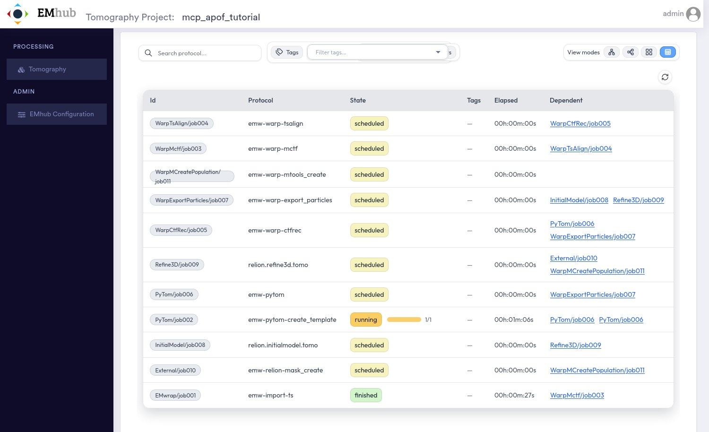

*Shortly after scheduling: the import has finished on the EMhub host, the PyTOM template is running on phys-a, and the other jobs are scheduled.*


The job forms show what the assistant set. This is the import job's form, with the
data paths and acquisition parameters from the workflow:

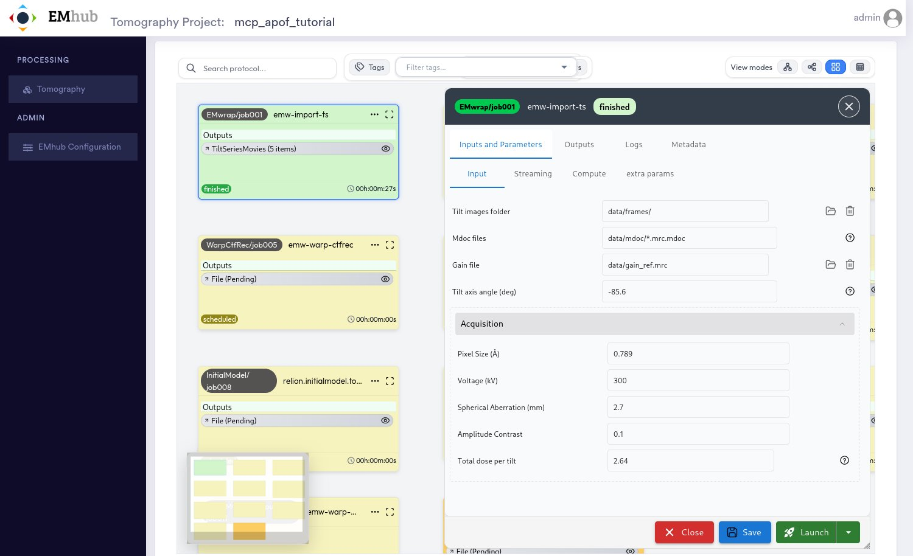

*The EMwrap Import TS form, opened from the grid view (double-click a job).*


## Following the Run

You do not need to stay in the conversation while jobs run. EMhub's scheduler submits
each job when its parents have finished. Come back whenever you like and ask how it is
going. Preprocessing took about 20 minutes:

**You:**

> How is the pipeline doing? Did the preprocessing work for all tilt series, and can you show me a slice through one of the tomograms?

<details><summary>15 tool calls: get_project, get_job, get_job_logs, get_jobs, get_star_table, list_project_files, read_project_file</summary><ol><li><code>get_project(project_id=1)</code></li><li><code>get_job(project_id=1, job_id=&quot;PyTom/job006&quot;)</code></li><li><code>get_job_logs(project_id=1, job_id=&quot;PyTom/job006&quot;, streams=[&quot;job_log&quot;, &quot;stdout&quot;, &quot;stderr&quot;], tail_lines=60)</code></li><li><code>get_jobs(project_id=1, job_ids=[&quot;EMwrap/job001&quot;, &quot;WarpMctf/job003&quot;, &quot;WarpTsAlign/job004&quot;, &quot;WarpCtfRec/job005&quot;])</code></li><li><code>get_star_table(project_id=1, path=&quot;WarpCtfRec/job005/tomograms.star&quot;)</code></li><li><code>list_project_files(project_id=1, path=&quot;WarpCtfRec/job005/warp_tiltseries/reconstruction&quot;)</code></li><li><code>get_star_table(project_id=1, path=&quot;WarpTsAlign/job004/tilt_series/TS_1.star&quot;, limit=3)</code></li><li><code>get_star_table(project_id=1, path=&quot;WarpMctf/job003/tilt_series.star&quot;, limit=10)</code></li><li><code>get_star_table(project_id=1, path=&quot;WarpTsAlign/job004/tilt_series/TS_1.star&quot;, columns=[&quot;TomoNominalStageTiltAngle&quot;, &quot;DefocusU&quot;, &quot;CtfMaxResolution&quot;, &quot;AccumMotionTotal&quot;], limit=50)</code></li><li><code>get_star_table(project_id=1, path=&quot;WarpTsAlign/job004/tilt_series/TS_11.star&quot;, columns=[&quot;TomoNominalStageTiltAngle&quot;, &quot;DefocusU&quot;, &quot;CtfMaxResolution&quot;, &quot;AccumMotionTotal&quot;], limit=50)</code></li><li><code>get_star_table(project_id=1, path=&quot;WarpTsAlign/job004/tilt_series/TS_17.star&quot;, columns=[&quot;TomoNominalStageTiltAngle&quot;, &quot;DefocusU&quot;, &quot;CtfMaxResolution&quot;, &quot;AccumMotionTotal&quot;], limit=50)</code></li><li><code>get_star_table(project_id=1, path=&quot;WarpTsAlign/job004/tilt_series/TS_23.star&quot;, columns=[&quot;TomoNominalStageTiltAngle&quot;, &quot;DefocusU&quot;, &quot;CtfMaxResolution&quot;, &quot;AccumMotionTotal&quot;], limit=50)</code></li><li><code>get_star_table(project_id=1, path=&quot;WarpTsAlign/job004/tilt_series/TS_32.star&quot;, columns=[&quot;TomoNominalStageTiltAngle&quot;, &quot;DefocusU&quot;, &quot;CtfMaxResolution&quot;, &quot;AccumMotionTotal&quot;], limit=50)</code></li><li><code>read_project_file(project_id=1, path=&quot;WarpCtfRec/job005/warp_tiltseries/reconstruction/TS_1_10.00Apx.mrc&quot;, as_image=true)</code></li><li><code>read_project_file(project_id=1, path=&quot;WarpCtfRec/job005/warp_tiltseries/reconstruction/TS_1_10.00Apx.png&quot;, as_image=true)</code></li></ol></details>

**Assistant:**

> Preprocessing worked for all 5 tilt series. One tilt series, TS_17, has 3 bad tilts that stayed in. Template matching (job006) is running now, and the 5 jobs after it are queued behind it.
>
> **Pipeline status**
>
> | Job | Status | Run time |
> |---|---|---|
> | `EMwrap/job001` import | finished | 27 s |
> | `PyTom/job002` create template | finished | 3 min 45 s |
> | `WarpMctf/job003` motion + CTF | finished | 2 min 11 s |
> | `WarpTsAlign/job004` alignment | finished | 1 min 15 s |
> | `WarpCtfRec/job005` CTF + reconstruction | finished | 4 min 15 s |
> | `PyTom/job006` template matching | **running** since 19:18:55 on `phys-a` (Slurm 7123787, 2 GPUs) | — |
> | job007 to job011 | scheduled | — |
>
> None of the finished jobs logged errors or warnings.
>
> **Preprocessing per tilt series**
>
> All 5 kept every one of their 41 tilts (−40° to +40°), and each has a tomogram plus even/odd half tomograms at 10 Å/pixel (348 × 474 × 78 voxels). Defocus is about 2.5–2.6 µm everywhere, close to the 2 µm target.
>
> | Tilt series | Defocus (µm) | CTF fit resolution (Å) | Notes |
> |---|---|---|---|
> | TS_1 | 2.55 | 4.4–7.9 | The +38° tilt is a mild outlier: defocus 2.1 µm, 3.3 Å drift. |
> | TS_11 | 2.54 | 3.6–6.5 | Cleanest of the five; drift at most 2.1 Å. |
> | TS_17 | 2.64 | 3.5–11.5 | **The −18°, −16° and −14° tilts look bad**: their fitted defocus is 1.25, 7.4 and 2.0 µm, and the sample drifted 2.0, 9.2 and 6.4 Å during them. The −16° fit failed (11.5 Å, near the top of the defocus search range). |
> | TS_23 | 2.61 | 4.7–7.5 | 6.9 Å drift on the 0° tilt. That tilt is the first exposure, where extra drift is normal. |
> | TS_32 | 2.54 | 4.6–7.8 | Drift is higher overall (up to 6.8 Å at high tilts), but the CTF fits are fine. |
>
> The 3 TS_17 tilts may slightly degrade that tomogram and its particles. For the tutorial I'd leave them in. Removing them later would mean redoing alignment and everything after it for that tilt series.
>
> **Tomogram slice (TS_1)**
>
> This is Warp's central slice of the TS_1 tomogram. Apoferritin particles are clearly visible as small rings, packed densely in the right half of the slice and more sparsely on the left. The full-size image is here:
>
> `/ptmp/secruz/software_development/emHubTomo/dev/projects/mcp_apof_tutorial/WarpCtfRec/job005/warp_tiltseries/reconstruction/TS_1_10.00Apx.png`
>
> There are matching PNGs for the other 4 tomograms in the same folder.
>
> **Three server problems, since you're developing this server**
>
> 1. **A stale status that could trigger a double launch.** My first status check reported job006 as `saved` and "ready to run" just as the scheduler was launching it. Its log shows it was being watched the whole time. A client that trusted that status could launch the job a second time. I took no action on it.
> 2. **Unusable tomogram preview.** Asking the server for a preview of the tomogram `.mrc` returned a tiny 2 × 2 grid of slices, because it read the file as a stack of 2D images. No particles were visible, so I used Warp's PNG instead.
> 3. **Missing inputs.** Job details now list no inputs for jobs 003–006, though they showed them before the run.

<sub>15 tool calls · 86 s</sub>


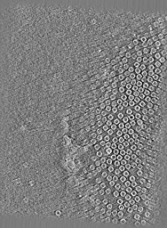

*What the assistant saw: Warp's central slice of the TS_1 tomogram (10 Å/pixel). The ring-shaped particles are apoferritin.*


> [!TIP]
> **Fixed after this step**
>
> The three problems the assistant reported were real and were fixed during the run:
>
> 1. **A job about to start could look ready to run.** While EMhub's scheduler submits
>    a job, the job briefly reads as *saved* (an emwrap issue, recorded for its developers). The MCP server now
>    refuses to run or schedule such a job, so it cannot be submitted twice.
> 2. **Tomogram previews were a montage of the first slices.** The server now asks EMhub
>    for the central section, as in the next answer.
> 3. **Finished jobs listed no inputs.** They are now taken from the job's parameters.

## Particle Picking

Template matching and the particle export ran next (about 10 minutes):

**You:**

> Template matching and the particle export have finished. How many particles were picked in each tomogram, and how many were exported for refinement? Show me the TS_11 tomogram as well.

<details><summary>11 tool calls: get_project, list_project_files, get_star_table, read_project_file, get_job_logs</summary><ol><li><code>get_project(project_id=1)</code></li><li><code>list_project_files(project_id=1, path=&quot;PyTom/job006&quot;)</code></li><li><code>list_project_files(project_id=1, path=&quot;WarpExportParticles/job007&quot;)</code></li><li><code>get_star_table(project_id=1, path=&quot;PyTom/job006/particles.star&quot;, count_by=&quot;TomoName&quot;, limit=0)</code></li><li><code>get_star_table(project_id=1, path=&quot;WarpExportParticles/job007/particles.star&quot;, count_by=&quot;TomoName&quot;, limit=0)</code></li><li><code>get_star_table(project_id=1, path=&quot;WarpExportParticles/job007/all_coordinates.star&quot;, count_by=&quot;TomoName&quot;, limit=0)</code></li><li><code>get_star_table(project_id=1, path=&quot;WarpExportParticles/job007/particles_original.star&quot;, count_by=&quot;TomoName&quot;, limit=0)</code></li><li><code>read_project_file(project_id=1, path=&quot;WarpExportParticles/job007/note.txt&quot;)</code></li><li><code>get_job_logs(project_id=1, job_id=&quot;WarpExportParticles/job007&quot;, streams=[&quot;stdout&quot;], tail_lines=80)</code></li><li><code>read_project_file(project_id=1, path=&quot;WarpCtfRec/job005/warp_tiltseries/reconstruction/TS_11_10.00Apx.png&quot;, as_image=true)</code></li><li><code>get_job_logs(project_id=1, job_id=&quot;InitialModel/job008&quot;, streams=[&quot;job_log&quot;], tail_lines=8)</code></li></ol></details>

**Assistant:**

> PyTOM picked 3,992 particles across the 5 tomograms, and 3,797 of them (95%) were exported for refinement.
>
> | Tomogram | Picked (PyTOM) | Exported (Warp) | Dropped |
> |---|---|---|---|
> | TS_11 | 1,191 | 1,127 | 64 |
> | TS_17 | 713 | 673 | 40 |
> | TS_23 | 702 | 663 | 39 |
> | TS_32 | 699 | 683 | 16 |
> | TS_1 | 687 | 651 | 36 |
> | **Total** | **3,992** | **3,797** | **195** |
>
> - **Picking:** no tomogram reached the template-matching cap of 2,500 particles, so these counts are what PyTOM itself accepted.
> - **Export:** Warp received all 3,992 particles and exported them as 64-pixel 2D tilt images at 4 Å/pixel. Its log doesn't say why 195 were left out. The likely reason is its default `max_missing_tilts = 5`: particles near the tomogram edges fall outside more than 5 of the tilted images and get skipped. Each tomogram lost 2–5% of its particles, which fits that explanation.
> - **TS_17:** its 3 bad tilts didn't hurt picking. Its count is in line with TS_1, TS_23 and TS_32.
>
> **TS_11 tomogram**
>
> The central slice of TS_11 shows apoferritin packed densely and evenly across almost the whole field of view. That's why it gave about 1.7× as many particles as the others. Fewer particles stand out at the edges, which fits the export dropping particles there. The full-size image is here:
>
> `/ptmp/secruz/software_development/emHubTomo/dev/projects/mcp_apof_tutorial/WarpCtfRec/job005/warp_tiltseries/reconstruction/TS_11_10.00Apx.png`
>
> **Next step:** the RELION initial model (job008) is still scheduled. The export finished at 19:30:01, after the job's last check at 19:28:56, so it should start at its next check around 19:34. Refine3D, the mask and the M population job follow automatically.

<sub>11 tool calls · 29 s</sub>


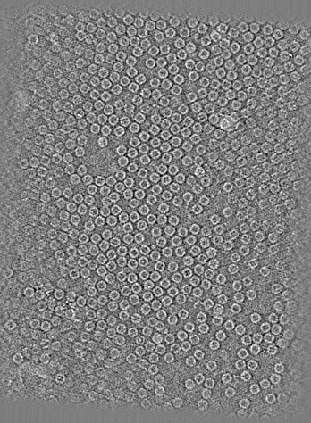

*The TS_11 tomogram the assistant looked at.*


The same results in the web interface: the eye icon of the PyTOM job's
``TomoCoordinates`` output lists the tomograms. Clicking a tomogram opens the viewer
with the picked particles:

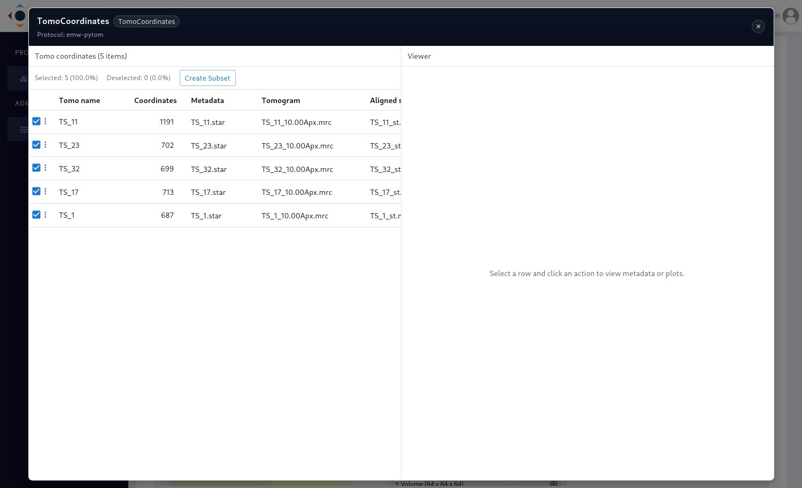

*The TomoCoordinates output of PyTom/job006: particles per tomogram.*


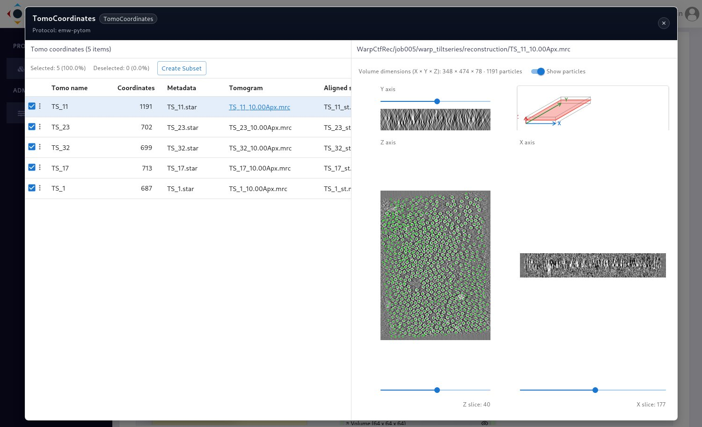

*TS_11 in the tomogram viewer, with its 1,191 picked particles (green).*


## Initial 3D Refinement

The RELION initial model, Refine3D, the mask and the M population followed (about 1.5
hours, most of it Refine3D). Then part 1 was done. Before going on, ask what came out:

**You:**

> Is part 1 finished? What resolution did the RELION refinement reach, and how do the initial model and the refined map look? Is there anything I should check before starting part 2?

<details><summary>19 tool calls: get_project, get_jobs, get_job_logs, list_project_files, read_project_file, load_workflow_template, get_star_table</summary><ol><li><code>get_project(project_id=1)</code></li><li><code>get_jobs(project_id=1, job_ids=[&quot;InitialModel/job008&quot;, &quot;Refine3D/job009&quot;, &quot;External/job010&quot;, &quot;WarpMCreatePopulation/job011&quot;])</code></li><li><code>get_job_logs(project_id=1, job_id=&quot;Refine3D/job009&quot;, streams=[&quot;stdout&quot;], contains=&quot;resolution&quot;, tail_lines=60)</code></li><li><code>list_project_files(project_id=1, path=&quot;Refine3D/job009&quot;, pattern=&quot;run_[!i]*&quot;)</code></li><li><code>list_project_files(project_id=1, path=&quot;InitialModel/job008&quot;, pattern=&quot;*[!0-9].*&quot;)</code></li><li><code>read_project_file(project_id=1, path=&quot;Refine3D/job009/job.script&quot;)</code></li><li><code>get_job_logs(project_id=1, job_id=&quot;External/job010&quot;, tail_lines=30)</code></li><li><code>read_project_file(project_id=1, path=&quot;InitialModel/job008/initial_model.mrc&quot;, as_image=true)</code></li><li><code>read_project_file(project_id=1, path=&quot;Refine3D/job009/run_class001.mrc&quot;, as_image=true)</code></li><li><code>read_project_file(project_id=1, path=&quot;External/job010/mask.mrc&quot;, as_image=true)</code></li><li><code>read_project_file(project_id=1, path=&quot;InitialModel/job008/run.err&quot;)</code></li><li><code>get_job_logs(project_id=1, job_id=&quot;WarpMCreatePopulation/job011&quot;, tail_lines=50)</code></li><li><code>load_workflow_template(project_id=1, workflow_id=&quot;apof-warp-tutorial-part2&quot;, dry_run=true)</code></li><li><code>get_star_table(project_id=1, path=&quot;Refine3D/job009/run_data.star&quot;, table=&quot;particles&quot;, count_by=&quot;TomoName&quot;, limit=0)</code></li><li><code>list_project_files(project_id=1, path=&quot;WarpMCreatePopulation/job011/m/species/ApoF_36bd26f3&quot;)</code></li><li><code>get_job_logs(project_id=1, job_id=&quot;WarpMCreatePopulation/job011&quot;, streams=[&quot;stdout&quot;], contains=&quot;particle&quot;, tail_lines=30)</code></li><li><code>get_star_table(project_id=1, path=&quot;WarpMCreatePopulation/job011/m/species/ApoF_36bd26f3/ApoF_particles.star&quot;, limit=0)</code></li><li><code>read_project_file(project_id=1, path=&quot;WarpMCreatePopulation/job011/m/species/ApoF_36bd26f3/ApoF.species&quot;)</code></li><li><code>read_project_file(project_id=1, path=&quot;WarpMCreatePopulation/job011/m/ApoF.population&quot;)</code></li></ol></details>

**Assistant:**

> Part 1 is finished: all 11 jobs completed. The RELION refinement reached **8.26 Å**, which is the limit for the 4 Å/pixel particles exported for this step, and both maps look like apoferritin. Before part 2, the main things to check are how its first job connects to part 1's output and its queue and GPU settings.
>
> **Run times of the last four jobs**
>
> | Job | Run time | Result |
> |---|---|---|
> | `InitialModel/job008` | 17 min | `initial_model.mrc` |
> | `Refine3D/job009` | 40 min | 8.26 Å, using all 3,797 particles |
> | `External/job010` mask | 1 s | `mask.mrc` |
> | `WarpMCreatePopulation/job011` | 16.5 min, mostly training M's denoiser | the M population with one source and one species (ApoF), 3,797 particles at 0.7894 Å/pixel |
>
> **Resolution**
>
> - Over the iterations, the resolution went 19.7 → 13.5 → 12.2 → 11.6 → 11.1 → 10.2 Å, and the final value is 8.26 Å. It's the unmasked gold-standard FSC value.
> - The particles are 4 Å/pixel, so the best this refinement could reach was 8.0 Å. RELION got about as far as it could.
> - Better resolution should come in part 2: M works on the full-resolution images at 0.7894 Å/pixel.
> - Refine3D got 2 GPUs on the cluster (`--gres=gpu:rtx6000:2` in its job script), even though its saved GPU count is 3. That settles the mismatch from earlier: for RELION jobs the server goes by the GPUs RELION is told to use.
>
> **What the maps look like**
>
> These are central slices from the server's previews. They're only 64 × 64 pixels, enough to judge the overall shape but not fine detail.
> - **Initial model:** the hollow apoferritin shell shows as a ring, with symmetric density around it.
> - **Refined map:** the same ring, sharper and with more defined features in the shell. Nothing looks wrong.
> - **Mask:** a tight, hard-edged shell that follows the ring. As far as I know, M expects a tight mask and softens it itself, so the missing soft edge should be fine. It's worth a quick 3D look to confirm it covers the whole shell and nothing else.
>
> To look at them in 3D (for example in ChimeraX):
> - `/ptmp/secruz/software_development/emHubTomo/dev/projects/mcp_apof_tutorial/InitialModel/job008/initial_model.mrc`
> - `/ptmp/secruz/software_development/emHubTomo/dev/projects/mcp_apof_tutorial/Refine3D/job009/run_class001.mrc`
> - `/ptmp/secruz/software_development/emHubTomo/dev/projects/mcp_apof_tutorial/External/job010/mask.mrc`
>
> **Before starting part 2**
>
> 1. **The link to part 1.** In the template, part 2's first M job reads the population from `WarpMCreatePopulation/job022`. In your project that job is `job011`. A test load of part 2 (nothing saved) added 11 jobs without warnings, but it doesn't show where the inputs point. After loading, the first M job's input should be `WarpMCreatePopulation/job011/m/ApoF.population`.
> 2. **Queue and GPUs.** The template's M jobs probably come without a queue, like part 1's did. They need the same check: `phys-a`, at most 3 GPUs each, confirmed with a dry run.
> 3. **A first M run that changes nothing.** When it created the species, M recommended running it once with all refinements turned off to check that the maps it produces match the input. After loading, check whether part 2's first M job is that kind of run.
> 4. **TS_17's bad tilts are still in.** Part 2 has two weight-estimation jobs, which should give poor tilts like those less weight. I don't think it needs action now.
>
> **A server issue:** the server flags `InitialModel/job008` as "finished, but outputs are missing". Its job definition expects a `run_optimisation_set.star` that RELION's initial-model step doesn't write; RELION wrote `run_it050_optimisation_set.star` instead. Refine3D only used `initial_model.mrc` and the particles from job007, so the results aren't affected. The fix belongs in the job definition.
>
> I can load part 2, check the link and the queue and GPU settings, and show you a dry run, without running anything.

<sub>19 tool calls · 99 s</sub>


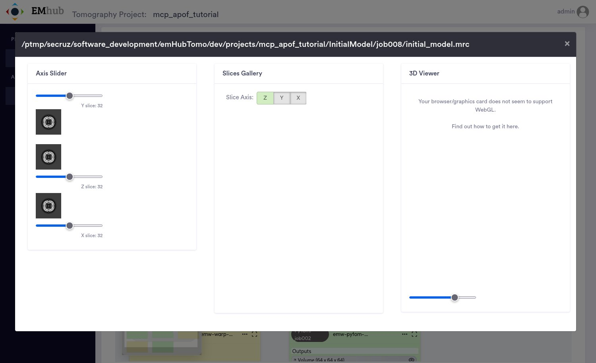

*The initial model in EMhub's map viewer (eye icon of the Volume output). The 3D panel needs WebGL, which the headless browser used for these screenshots did not have; in a normal browser it shows an isosurface.*


## Part 2: M Refinements

Part 2 is a separate sitting, so it starts a new conversation. The assistant knows
nothing of the first one and finds its way through the project itself.

**You:**

> In EMhub-Tomo project 1, part 1 of the ApoF tutorial has finished. Load part 2 (the M refinements) into the same project. Check that its first job reads the M population from part 1, and that every GPU job goes to phys-a with at most 3 GPUs. Show me a dry run before scheduling anything.

<details><summary>21 tool calls: get_project, list_workflow_templates, load_workflow_template, get_jobs, describe_job_type, save_job, get_job, schedule_jobs</summary><ol><li><code>get_project(project_id=1)</code></li><li><code>list_workflow_templates()</code></li><li><code>load_workflow_template(project_id=1, workflow_id=&quot;apof-warp-tutorial-part2&quot;, dry_run=true)</code></li><li><code>load_workflow_template(project_id=1, workflow_id=&quot;apof-warp-tutorial-part2&quot;)</code></li><li><code>get_jobs(project_id=1, job_ids=[&quot;WarpMCore/job012&quot;, &quot;WarpMCore/job013&quot;, &quot;WarpMCore/job014&quot;, &quot;WarpMCore/job015&quot;, &quot;WarpMCore/job016&quot;, &quot;WarpEstimateWei…)</code></li><li><code>describe_job_type(job_type=&quot;emw-warp-mcore&quot;, project_id=1)</code></li><li><code>describe_job_type(job_type=&quot;emw-warp-estimate_weights&quot;, project_id=1)</code></li><li><code>describe_job_type(job_type=&quot;emw-warp-mtools_resample&quot;, project_id=1)</code></li><li><code>save_job(project_id=1, job_id=&quot;WarpMCore/job012&quot;, params={&quot;mcore.population&quot;: &quot;WarpMCreatePopulation/job011/m/ApoF.population&quot;, &quot;queue.name&quot;: &quot;phys-a&quot;})</code></li><li><code>save_job(project_id=1, job_id=&quot;WarpMCore/job013&quot;, params={&quot;queue.name&quot;: &quot;phys-a&quot;})</code></li><li><code>save_job(project_id=1, job_id=&quot;WarpMCore/job014&quot;, params={&quot;queue.name&quot;: &quot;phys-a&quot;})</code></li><li><code>save_job(project_id=1, job_id=&quot;WarpMCore/job015&quot;, params={&quot;queue.name&quot;: &quot;phys-a&quot;})</code></li><li><code>save_job(project_id=1, job_id=&quot;WarpMCore/job016&quot;, params={&quot;queue.name&quot;: &quot;phys-a&quot;})</code></li><li><code>save_job(project_id=1, job_id=&quot;WarpEstimateWeights/job017&quot;, params={&quot;queue.name&quot;: &quot;phys-a&quot;})</code></li><li><code>save_job(project_id=1, job_id=&quot;WarpMCore/job018&quot;, params={&quot;queue.name&quot;: &quot;phys-a&quot;})</code></li><li><code>save_job(project_id=1, job_id=&quot;WarpEstimateWeights/job019&quot;, params={&quot;queue.name&quot;: &quot;phys-a&quot;})</code></li><li><code>save_job(project_id=1, job_id=&quot;WarpMCore/job020&quot;, params={&quot;queue.name&quot;: &quot;phys-a&quot;})</code></li><li><code>save_job(project_id=1, job_id=&quot;WarpMResample/job021&quot;, params={&quot;queue.name&quot;: &quot;phys-a&quot;})</code></li><li><code>save_job(project_id=1, job_id=&quot;WarpMCore/job022&quot;, params={&quot;queue.name&quot;: &quot;phys-a&quot;})</code></li><li><code>get_job(project_id=1, job_id=&quot;WarpMCore/job012&quot;)</code></li><li><code>schedule_jobs(project_id=1, job_ids=[&quot;WarpMCore/job012&quot;, &quot;WarpMCore/job013&quot;, &quot;WarpMCore/job014&quot;, &quot;WarpMCore/job015&quot;, &quot;WarpMCore/job016&quot;, &quot;WarpEstimateWei…, dry_run=true)</code></li></ol></details>

**Assistant:**

> I loaded part 2 into project 1 as 11 saved jobs, `WarpMCore/job012` to `WarpMCore/job022`. Nothing has been scheduled or run.
>
> **I fixed two problems after loading:**
>
> 1. **The first job didn't read part 1's M population.** `WarpMCore/job012` pointed at `WarpMCreatePopulation/job022/m/ApoF.population`. That's the job's ID inside the template file; the loader didn't change it to part 1's job ID. I set it to `WarpMCreatePopulation/job011/m/ApoF.population`, which exists. job012's parent is now `WarpMCreatePopulation/job011`. The other ten jobs already chained to each other correctly.
> 2. **No job had a queue set.** I set the queue to `phys-a` on all 11.
>
> **Dry run of scheduling all 11 jobs** (each checks every 5 min and starts once its parent finishes):
>
> | Job | Queue | GPUs |
> |---|---|---|
> | WarpMCore/job012 (reads job011) | phys-a | 2 |
> | WarpMCore/job013 | phys-a | 2 |
> | WarpMCore/job014 | phys-a | 2 |
> | WarpMCore/job015 | phys-a | 2 |
> | WarpMCore/job016 | phys-a | 2 |
> | WarpEstimateWeights/job017 | phys-a | 1 |
> | WarpMCore/job018 | phys-a | 2 |
> | WarpEstimateWeights/job019 | phys-a | 1 |
> | WarpMCore/job020 | phys-a | 2 |
> | WarpMResample/job021 | phys-a | 1 |
> | WarpMCore/job022 | phys-a | 2 |
>
> Every job goes to phys-a and none uses more than 2 GPUs, so all are within your limit of 3. The server reported no warnings or refusals. I left the template's GPU counts and refinement settings as they were.
>
> Should I schedule all 11? The job ID not being updated looks like an upstream loader bug. I can also add it to `UPSTREAM_ISSUES.md` if you want.

<sub>21 tool calls · 63 s</sub>


> [!WARNING]
> **A problem in the tutorial workflow itself**
>
> The assistant caught a problem in the workflow files that affects anyone following the
> [Warp ApoF Tutorial](https://3dem.github.io/emhub-tomo/warp_apof_tutorial.html). Part 2's first job reads the M population from
> ``WarpMCreatePopulation/job022``, the job's number inside part 1's workflow file. But
> part 1's jobs are numbered from ``job001`` when they are loaded into a project, so that
> job is ``WarpMCreatePopulation/job011`` here. Without the fix, the first M job would
> have failed. In the web interface, set the job's **Population file** to part 1's
> population after loading part 2. The problem is recorded for the emwrap developers.

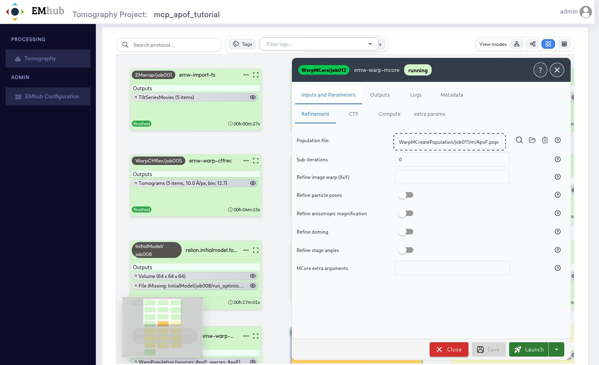

*The first M job after the assistant's fix: it reads part 1's population (job011). All refinements are off in this first round, which checks that M reproduces the input map.*


**You:**

> Yes, schedule all 11.

<details><summary>1 tool calls: schedule_jobs</summary><ol><li><code>schedule_jobs(project_id=1, job_ids=[&quot;WarpMCore/job012&quot;, &quot;WarpMCore/job013&quot;, &quot;WarpMCore/job014&quot;, &quot;WarpMCore/job015&quot;, &quot;WarpMCore/job016&quot;, &quot;WarpEstimateWei…)</code></li></ol></details>

**Assistant:**

> All 11 jobs are scheduled on phys-a with the queue and GPU counts from the dry run, and the server reported no warnings.
>
> - **`WarpMCore/job012` has been launched**, because its parent `WarpMCreatePopulation/job011` had already finished. It reads job011's population on phys-a with 2 GPUs.
> - **job013 to job022 are waiting.** Each one checks every 5 minutes and starts once the job before it finishes, so they run one after another.
>
> Part 1's jobs took between seconds and about 40 minutes each, so this chain will likely take several hours. I can follow it and tell you when it finishes or if a job fails.

<sub>1 tool calls · 15 s</sub>


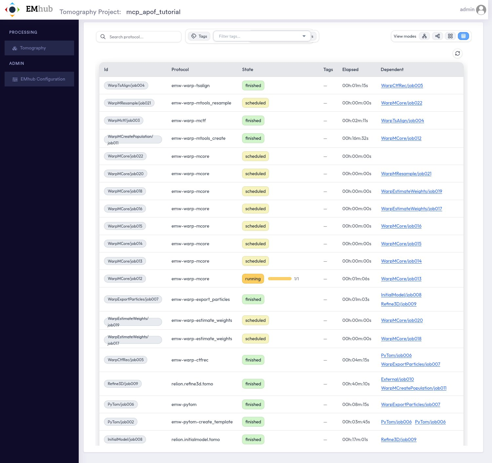

*All 22 jobs: part 1 finished, part 2 scheduled, its first M job running.*


### Following Part 2

Each M round runs for 20 to 25 minutes on 2 GPUs. The eye icon of a ``WarpPopulation``
output opens the population viewer. It lists M's files (maps, half maps, masks, local
resolution) and plots M's Fourier Shell Correlation curves:

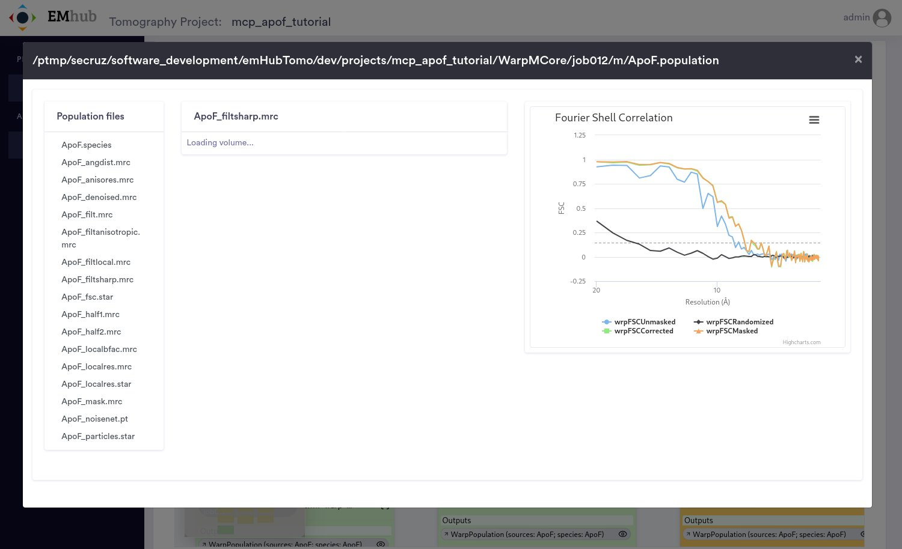

*The population after the first M round (WarpMCore/job012, refinements off): M's files and its FSC curves. The map panel needs WebGL (see above).*


After five rounds, ask how it is going:

**You:**

> How are the M refinements going? Which resolution did M reach after each round so far, and is it still improving?

<details><summary>16 tool calls: get_project, get_job_logs, list_project_files</summary><ol><li><code>get_project(project_id=1, job_types=[&quot;emw-warp-mcore&quot;, &quot;emw-warp-estimate_weights&quot;, &quot;emw-warp-mtools_resample&quot;])</code></li><li><code>get_job_logs(project_id=1, job_id=&quot;WarpMCore/job012&quot;, contains=&quot;resolution&quot;, tail_lines=40)</code></li><li><code>get_job_logs(project_id=1, job_id=&quot;WarpMCore/job013&quot;, contains=&quot;resolution&quot;, tail_lines=40)</code></li><li><code>get_job_logs(project_id=1, job_id=&quot;WarpMCore/job014&quot;, contains=&quot;resolution&quot;, tail_lines=40)</code></li><li><code>get_job_logs(project_id=1, job_id=&quot;WarpMCore/job015&quot;, contains=&quot;resolution&quot;, tail_lines=40)</code></li><li><code>get_job_logs(project_id=1, job_id=&quot;WarpMCore/job016&quot;, contains=&quot;resolution&quot;, tail_lines=40)</code></li><li><code>get_job_logs(project_id=1, job_id=&quot;WarpMCore/job016&quot;, tail_lines=80, streams=[&quot;stdout&quot;, &quot;stderr&quot;, &quot;job_log&quot;])</code></li><li><code>list_project_files(project_id=1, path=&quot;WarpMCore/job016&quot;)</code></li><li><code>get_job_logs(project_id=1, job_id=&quot;WarpMCore/job012&quot;, contains=&quot;Å&quot;, streams=[&quot;stdout&quot;])</code></li><li><code>get_job_logs(project_id=1, job_id=&quot;WarpMCore/job013&quot;, contains=&quot;Å&quot;, streams=[&quot;stdout&quot;])</code></li><li><code>get_job_logs(project_id=1, job_id=&quot;WarpMCore/job014&quot;, contains=&quot;Å&quot;, streams=[&quot;stdout&quot;])</code></li><li><code>get_job_logs(project_id=1, job_id=&quot;WarpMCore/job015&quot;, contains=&quot;Å&quot;, streams=[&quot;stdout&quot;])</code></li><li><code>get_job_logs(project_id=1, job_id=&quot;WarpMCreatePopulation/job011&quot;, contains=&quot;Å&quot;, streams=[&quot;stdout&quot;])</code></li><li><code>get_job_logs(project_id=1, job_id=&quot;WarpEstimateWeights/job017&quot;, tail_lines=30, streams=[&quot;stdout&quot;, &quot;stderr&quot;])</code></li><li><code>get_job_logs(project_id=1, job_id=&quot;Refine3D/job009&quot;, contains=&quot;final resolution&quot;, streams=[&quot;stdout&quot;])</code></li><li><code>get_project(project_id=1, statuses=[&quot;launched&quot;, &quot;running&quot;, &quot;scheduled&quot;, &quot;failed&quot;, &quot;aborted&quot;])</code></li></ol></details>

**Assistant:**

> The M refinements are going well. Five M rounds have finished and each one reached a better resolution than the last, but the gains are getting smaller. No job has failed and none of the logs show errors.
>
> | Round | What M refined | Resolution | Change |
> |---|---|---|---|
> | job012 | Nothing: 0 iterations, so this is the starting reconstruction | 7.72 Å | — |
> | job013 | Particle poses, 3×3 image warp, defocus (full search) | 3.79 Å | −3.93 Å |
> | job014 | The same, with a local defocus search | 3.22 Å | −0.57 Å |
> | job015 | Particle poses, image warp, stage angles | 3.05 Å | −0.17 Å |
> | job016 | Adds Cs, beam tilt and trefoil, magnification | **2.97 Å** | −0.08 Å |
>
> **Is it still improving?** Yes, but it's levelling off. Each round improved, and the improvement shrank from 0.57 to 0.17 to 0.08 Å. More rounds of the same refinements would add little. The remaining rounds do different things:
>
> - **job017** (per-particle weights) finished at 23:15. It doesn't report a resolution.
> - **job018** is scheduled and should start within 5 minutes of job017 finishing. It will give the first resolution with the new weights.
> - **job019 to job022** follow: per-frame weights, a refinement, trajectory resampling, and a final refinement with everything switched on. Whether these improve on 2.97 Å won't be known until they run.
>
> For reference, part 1's RELION refinement (`Refine3D/job009`) ended at 8.26 Å without masking. That's not a direct comparison, because M reports its own resolution measure.
>
> Rounds have taken 15–33 minutes each, so the rest of the chain should take about another 1.5–2 hours.

<sub>16 tool calls · 53 s</sub>


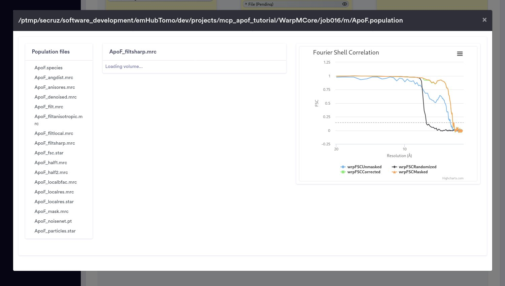

*The population after the fifth round (WarpMCore/job016): the FSC curves now reach about 3 Å.*


## Results

All 22 jobs finished, the last one at 00:35. Ask for the result and a report of the
whole run:

**You:**

> Part 2 has finished. What final resolution did M reach, and how did it develop over all the rounds? Then give me a short report of the whole tutorial run, parts 1 and 2: jobs, run times and results. Show me the final map too.

<details><summary>16 tool calls: get_project, get_job_logs, list_project_files, get_jobs, read_project_file, get_star_table</summary><ol><li><code>get_project(project_id=1)</code></li><li><code>get_job_logs(project_id=1, job_id=&quot;WarpMCore/job018&quot;, contains=&quot;Å&quot;, streams=[&quot;stdout&quot;])</code></li><li><code>get_job_logs(project_id=1, job_id=&quot;WarpMCore/job020&quot;, contains=&quot;Å&quot;, streams=[&quot;stdout&quot;])</code></li><li><code>get_job_logs(project_id=1, job_id=&quot;WarpMCore/job022&quot;, tail_lines=60, streams=[&quot;stdout&quot;, &quot;stderr&quot;])</code></li><li><code>list_project_files(project_id=1, path=&quot;WarpMCore/job022/m&quot;)</code></li><li><code>list_project_files(project_id=1, path=&quot;WarpMCore/job022/m/species&quot;)</code></li><li><code>get_jobs(project_id=1, job_ids=[&quot;EMwrap/job001&quot;, &quot;PyTom/job002&quot;, &quot;WarpMctf/job003&quot;, &quot;WarpTsAlign/job004&quot;, &quot;WarpCtfRec/job005&quot;, &quot;PyTom/job006&quot;, &quot;Warp…)</code></li><li><code>list_project_files(project_id=1, path=&quot;WarpMCore/job022/m/species/ApoF_36bd26f3&quot;)</code></li><li><code>read_project_file(project_id=1, path=&quot;WarpMCore/job022/m/species/ApoF_36bd26f3/ApoF_filtsharp.mrc&quot;, as_image=true)</code></li><li><code>get_star_table(project_id=1, path=&quot;WarpCtfRec/job005/tomograms.star&quot;, limit=0)</code></li><li><code>get_star_table(project_id=1, path=&quot;Refine3D/job009/run_data.star&quot;, limit=0, count_by=&quot;TomoName&quot;)</code></li><li><code>get_star_table(project_id=1, path=&quot;WarpMCore/job022/m/species/ApoF_36bd26f3/ApoF_particles.star&quot;, limit=0)</code></li><li><code>read_project_file(project_id=1, path=&quot;PyTom/job006/optimisation_set.star&quot;)</code></li><li><code>read_project_file(project_id=1, path=&quot;WarpMCore/job022/m/species/ApoF_36bd26f3/ApoF_denoised.mrc&quot;, as_image=true)</code></li><li><code>get_star_table(project_id=1, path=&quot;PyTom/job006/particles.star&quot;, limit=0, count_by=&quot;TomoName&quot;)</code></li><li><code>read_project_file(project_id=1, path=&quot;WarpMCore/job022/m/species/ApoF_36bd26f3/ApoF.species&quot;)</code></li></ol></details>

**Assistant:**

> M's final resolution is **2.90 Å**, from the last round, `WarpMCore/job022`. All 22 jobs of parts 1 and 2 finished and none failed.
>
> **How the resolution developed**
>
> | Step | What it did | Time | Resolution |
> |---|---|---|---|
> | Refine3D/job009 (part 1, RELION) | Final RELION refinement | 40 min | 8.26 Å (without masking) |
> | WarpMCore/job012 | Starting reconstruction in M, no refinement | 23 min | 7.72 Å |
> | WarpMCore/job013 | Particle poses, image warp, defocus (full search) | 24 min | 3.79 Å |
> | WarpMCore/job014 | The same, with a local defocus search | 30 min | 3.22 Å |
> | WarpMCore/job015 | Particle poses, image warp, stage angles | 15 min | 3.05 Å |
> | WarpMCore/job016 | Adds Cs, beam tilt and trefoil, magnification | 33 min | 2.97 Å |
> | WarpEstimateWeights/job017 | Per-particle weights | 8 s | — |
> | WarpMCore/job018 | Reconstruction with those weights, no refinement | 14 min | 2.96 Å |
> | WarpEstimateWeights/job019 | Per-frame weights | 9 s | — |
> | WarpMCore/job020 | Particle poses | 15 min | 2.93 Å |
> | WarpMResample/job021 | Trajectory resampling (2 samples) | 14 s | — |
> | WarpMCore/job022 | All refinements at once | 35 min | **2.90 Å** |
>
> - **The first real refinement gave the big jump**, from 7.72 to 3.79 Å.
> - **The next three rounds added smaller gains:** 0.57, 0.17 and 0.08 Å.
> - **Everything after job016 added only 0.07 Å in total**, and the last three resolutions differed by 0.01–0.03 Å each. The resolution has levelled off.
>
> RELION's 8.26 Å and M's numbers are measured differently, so the two aren't directly comparable.
>
> **Report on the whole tutorial run**
>
> **Overall:** 22 jobs took 4 h 43 min of run time: 1 h 35 min for part 1 and 3 h 8 min for part 2. Five tilt series gave 3,992 picked particles, 3,797 of which went through RELION and M to a 2.90 Å map. Part 2 took about 3.5 h from scheduling (about 21:05) to finishing (00:35). The extra time is queue waits plus the 5-minute checks for each job's parent. Every GPU job ran on phys-a.
>
> **Part 1** (part 2's jobs are the table above):
>
> | Job | Time | Result |
> |---|---|---|
> | EMwrap/job001 – import | 27 s | 5 tilt series |
> | PyTom/job002 – template | 4 min | Template and mask from EMD-15854 at 10 Å/px |
> | WarpMctf/job003 – motion and CTF | 2 min | Frames corrected |
> | WarpTsAlign/job004 – alignment | 1 min | Tilt series aligned |
> | WarpCtfRec/job005 – CTF and reconstruction | 4 min | 5 tomograms at 10 Å/px |
> | PyTom/job006 – template matching | 8 min | 3,992 particles (687–1,191 per tomogram) |
> | WarpExportParticles/job007 – export | 1 min | Particles at 4 Å/px, box 64 |
> | InitialModel/job008 – initial model | 17 min | Initial model with O symmetry |
> | Refine3D/job009 – refinement | 40 min | 3,797 particles, 8.26 Å |
> | External/job010 – mask | 1 s | Mask |
> | WarpMCreatePopulation/job011 – M population | 17 min | Population at 0.7894 Å/px |
>
> **Notes:**
>
> - **I fixed two things when loading part 2.** The template still pointed job012 at its own old job ID instead of job011, and no job had a queue set. The template ID bug isn't in `UPSTREAM_ISSUES.md` yet.
> - **`InitialModel/job008` has a RELION warning but is fine.** It's marked finished, but RELION warns that `run_optimisation_set.star` is missing. Refine3D only used `initial_model.mrc`, which exists, so the results aren't affected.
> - **195 particles were dropped** between picking (3,992) and RELION refinement (3,797). I didn't check which step dropped them.
>
> **Final map**
>
> The map is in `WarpMCore/job022/m/species/ApoF_36bd26f3/`. It's 354³ voxels at 0.7894 Å/px with O symmetry and a B-factor of −33. I made previews of the central slice (z = 177) of two versions:
>
> - **Sharpened** (`ApoF_filtsharp.mrc`): `/u/secruz/.claude/projects/-phys-ptmp-secruz-software-development-emHubTomo-dev-mcp-tutorial-session/63ca9c63-5c4b-460a-9b76-aa5867fdedb3/tool-results/mcp-emhub-tomo-blob-1792794955936-vph9s5.png`
> - **Denoised** (`ApoF_denoised.mrc`): `/u/secruz/.claude/projects/-phys-ptmp-secruz-software-development-emHubTomo-dev-mcp-tutorial-session/63ca9c63-5c4b-460a-9b76-aa5867fdedb3/tool-results/mcp-emhub-tomo-blob-1792794967236-8a4kuo.png`
>
> Both show the apoferritin shell as a ring about 12 nm across with a hollow interior. The fine detail around the ring has four-fold symmetry, because the slice is cut across one of the four-fold axes. The sharpened map has strong speckle noise outside the shell. The denoised map shows the same shell on a clean background.
>
> A single slice can't show side-chain detail. To check that, open the 3D map, for example: `chimerax /ptmp/secruz/software_development/emHubTomo/dev/projects/mcp_apof_tutorial/WarpMCore/job022/m/species/ApoF_36bd26f3/ApoF_denoised.mrc`

<sub>16 tool calls · 2 min</sub>


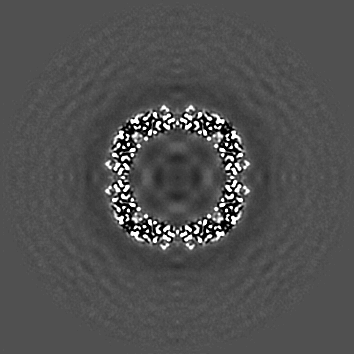

*What the assistant saw: the central section of the final denoised map (ApoF_denoised.mrc, 0.79 Å/pixel), across one of apoferritin's four-fold axes.*


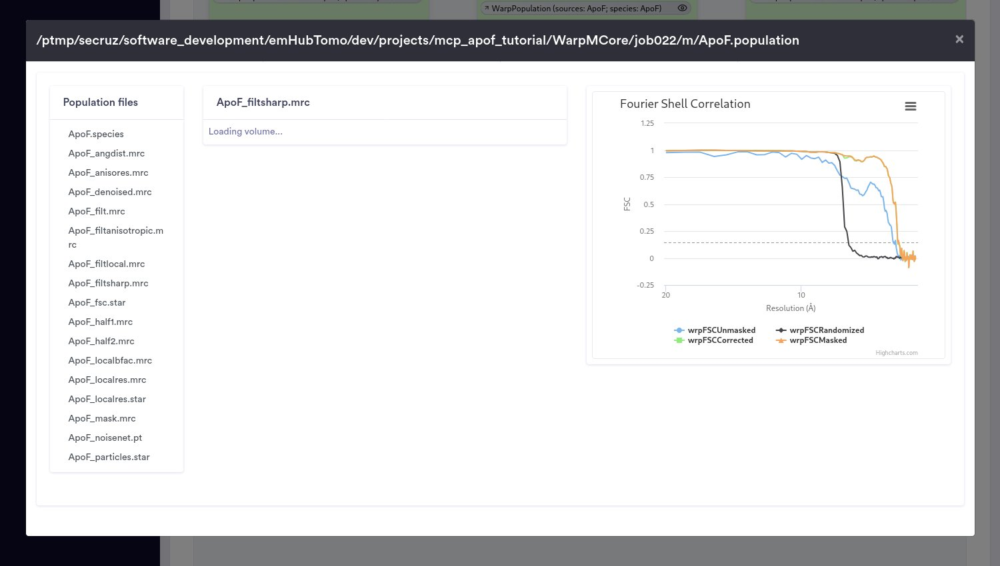

*The final population (WarpMCore/job022) in EMhub's population viewer, with M's FSC curves.*


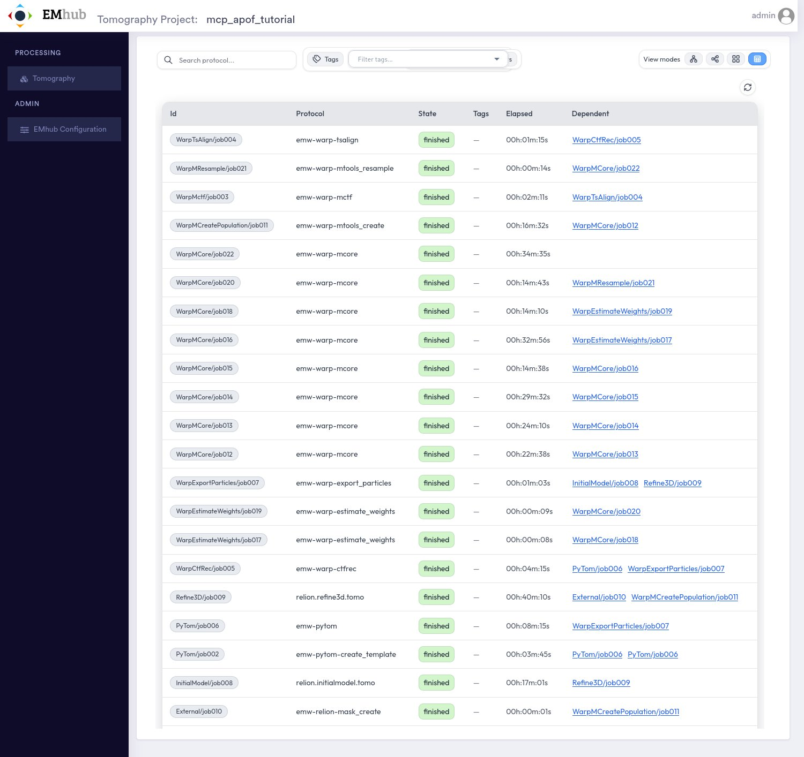

*The finished project: all 22 jobs of both parts.*


In short:

| | |
|---|---|
| Tilt series | 5 (TS_1, TS_11, TS_17, TS_23, TS_32), 41 tilts each |
| Particles picked by PyTOM | 3,992 (687 to 1,191 per tomogram) |
| Particles refined | 3,797 |
| RELION Refine3D (part 1) | 8.26 Å, limited by the 4 Å/pixel particles |
| M, after 7 refinement rounds (part 2) | **2.90 Å** |

## The Run in Numbers

| | Part 1 | Part 2 |
|---|---|---|
| Jobs | 11, all finished | 11, all finished |
| Wall time, from scheduling to the last job | 2 h 2 min | 3 h 30 min |
| Compute time (sum of the jobs' run times) | 1 h 35 min | 3 h 8 min |
| Longest job | Refine3D, 40 min | the last M round, 35 min |
| GPU jobs at once | 1, on ``phys-a`` | 1, on ``phys-a`` |
| Prompts typed | 7 (first conversation) | 4 (second conversation) |
| Tool calls by the assistant | 84 | 54 |
| Cost of the prompts | $9.84 | $3.82 |

In total: 22 jobs in 5 h 36 min, 11 prompts, 138 tool calls, $13.66.

The assistant was Claude Opus 5.5 in Claude Code. The cost of a prompt grows with the
conversation, because everything said before is sent again. In the first conversation
the prompts went from $0.17 to $3.54. The second conversation started fresh: its four
prompts cost $0.42 to $1.91.

## What to Ask

Ask the way you would ask a colleague who knows EMhub-Tomo. For example:

- *Which of my projects have failed jobs, and why did they fail?*
- *Show me the parameters of the tilt-series alignment in project 3, and compare them with project 2.*
- *How many particles were picked per tomogram? Show me a slice through TS_11.*
- *Set the import's tilt-axis angle to −85.6° and the pixel size to 0.789 Å, then run it.*
- *Schedule everything from motion correction to reconstruction on phys-a. Show me the dry run first.*
- *Stop the running refinement; I want to change the mask.*
- *Write a short report of project 1: jobs, run times and the resolution reached.*

## Good to Know

- **It asks before it acts.** Before running or scheduling anything, the assistant shows
  the plan (a dry run) and waits for your confirmation, unless you asked for exactly that.
- **The server has the last word.** It refuses what the operator does not allow: a GPU
  job on the login node, more GPUs than the limit, a project outside the allowed folders,
  or deleting jobs at the ``operate`` level. The assistant cannot change these limits.
- **Jobs do not depend on the conversation.** Once jobs are scheduled, EMhub runs them.
  You can close Claude Code and come back later, also from a new conversation.
- **Start a new conversation for a new task.** Long conversations get slow and expensive
  (see the numbers above).
- **Check what matters.** The assistant can misread a log or a value. Every job, form
  and result it mentions is also in the web interface.
- **Everything is logged.** Every change the assistant attempts is recorded in the audit
  log, ``audit.jsonl`` in ``EMHUB_TOMO_MCP_STATE_DIR``, with its outcome.
- **Read-only is the default.** For colleagues who only want to look, leave out
  ``EMHUB_TOMO_MCP_ACCESS``. The assistant can then explain, but not change, anything.

## What This Run Found

Running the tutorial this way was also a test of the MCP server and of the tutorial
itself. The assistant's own checks found:

| Found | Where | Status |
|---|---|---|
| RELION jobs were not counted as GPU jobs | MCP server | Fixed during the run |
| Tomogram previews showed a montage of the first slices | MCP server and EMhub | Fixed: the central section is shown |
| Finished jobs listed no inputs | MCP server (cause in emwrap) | Fixed: taken from the parameters |
| A job being started by the scheduler briefly reads as *saved* | emwrap | MCP server guards against it; recorded for emwrap |
| Part 2 of the tutorial points at part 1's population by the wrong job number | Tutorial workflow files | Corrected by the assistant; recorded for emwrap |
| RELION's initial model does not write the declared ``run_optimisation_set.star`` | RELION and the job definition | Harmless here; flagged by the server |
